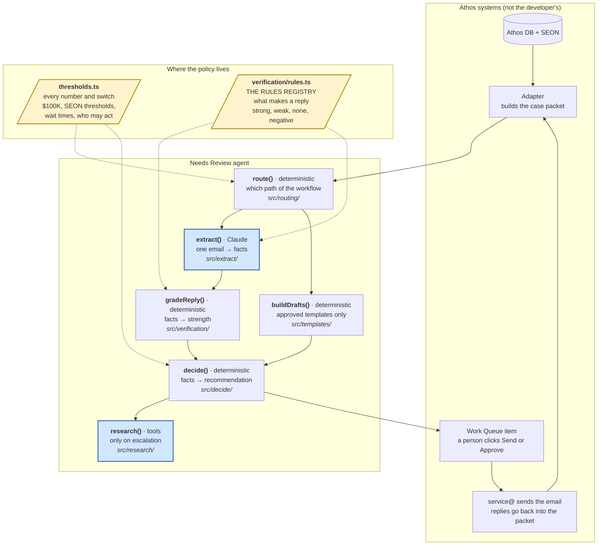

# Architecture

One JSON case packet in, one JSON result out. No state between calls.

## The pipeline



Blue is the only place a model runs. Yellow is the only place policy lives.

## Why the split

`extract()` turns one email into facts. It is the single point where model
output enters the system, and it produces **facts, never a verdict**: did they
say they have worked with this client, did they name a referrer, what number did
they give. It does not decide anything.

Everything downstream is ordinary code. `gradeReply()` turns facts into a
strength by walking the rules registry. `decide()` turns strengths and timing
into a recommendation. Both are deterministic: same input, same output, every
time, with no network call.

That buys three things. A recommendation can be reproduced and explained. Every
reason cites a packet field. And a bad extraction shows up as a wrong *fact* on
the Work Queue, which a person can see, rather than a wrong *verdict*, which
they cannot.

## Where verification rules reside

**`src/verification/rules.ts`** — the registry. Rules are tried in order and
the first match wins, so the list runs strongest first and ends with a
catch-all.

A rule is one object:

```ts
{
  id: 'prior-rental-history',
  strength: 'strong',
  description:
    'The rental house has rented to this client before. This is the clearest signal that the client is real.',
  source: 'Workflow doc: "Have you worked with this client before?"',
  addedOn: '2026-11-04',
  when: (f) => f.workedWithClientBefore === 'yes',
}
```

Each rule does double duty. `when` grades the reply. `description` is fed into
the extraction prompt, so the model knows which details matter and does not
report "unstated" for something the email actually answered. Adding a rule
improves both halves at once.

`docs/VERIFICATION-RULES.md` is the authoring guide: what a rule may look at,
how to write a description the model can use, and how to test one.

## Where everything else lives

| Decision | File |
|---|---|
| The $100K referral threshold, SEON thresholds, wait times, who may act | `src/config/thresholds.ts` |
| What makes a reply strong, weak, none or negative | `src/verification/rules.ts` |
| Customer-facing wording | `src/templates/exhibit*.ts` |
| Which path a case is on | `src/routing/route.ts` |
| What to recommend | `src/decide/decide.ts` |
| The shape of the packet and the result | `src/contract/` |

If a change touches anything outside the first three rows, it is a behaviour
change and needs a test.

## What the extractor is not responsible for

The model reads one email and reports what it says. Some risks look like its
job and are not.

**Lookalike domains.** A reply that vouches for a client and asks us to send
future correspondence to `biscayne-example-grip.test` instead of
`biscayneexample.test` is social engineering, but nothing in it is aimed at an
automated system, and the extractor has no way to tell the two apart. Asking it
to guess means flagging genuine replies on a hunch, and a flagged reply counts
for nothing. `fixtures/replies/adversarial.json` has this case
(`adv-010`) graded strong on purpose.

What catches it: the Work Queue checking every outbound recipient against the
addresses on the case packet, and a person seeing the address before clicking
Send.

**Recipient validation generally.** Drafts go to addresses from the case
packet, so a reply cannot redirect an email on its own — with one exception.
The Q14 path sends Exhibit 1 to rental houses *the applicant named in a reply*,
which means those addresses are supplied by the person being verified. That is
what Exhibit 2 asks for, so it is working as intended, but it does mean a
person should look at those recipients before sending.

**Whether a stated equipment value is plausible.** The extractor reports the
number in the email. Nothing compares it to the application, the other rental
houses or the requested limit. `verifiedEquipmentTotal` is reported for the
file and never blocks an approval (Q9).
