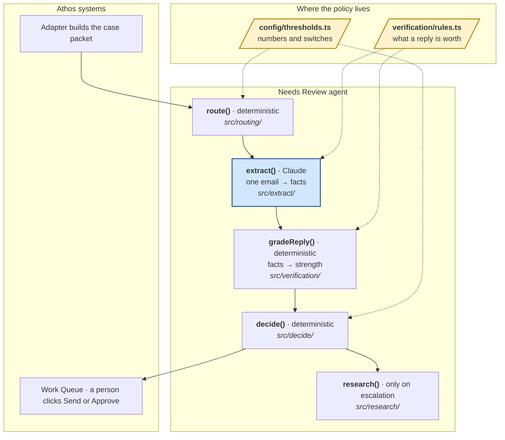

# Architecture

Blue is the only place a model runs. Yellow is the only place policy lives.

## The model never decides

`extract()` turns one email into facts: did they say they have worked with this
client, did they name a referrer, what number did they give. It is the only
model call, and it produces facts, never a verdict.

Everything after it is ordinary code. `gradeReply()` walks the rules registry
to turn facts into a strength. `decide()` turns strengths and timing into a
recommendation. Both are deterministic and make no network call.

That buys three things: a recommendation can be reproduced and explained, every
reason cites a packet field, and a bad extraction shows up on the Work Queue as
a wrong _fact_ a person can see rather than a wrong _verdict_ they cannot.

## Where things live

| To change…                                               | Edit                                                                             |
| -------------------------------------------------------- | -------------------------------------------------------------------------------- |
| the $100K line, SEON thresholds, wait times, who may act | `src/config/thresholds.ts`                                                       |
| what makes a reply strong, weak, none or negative        | `src/verification/rules.ts` — see [VERIFICATION-RULES.md](VERIFICATION-RULES.md) |
| customer-facing wording                                  | `src/templates/exhibit*.ts`                                                      |
| the shape of the packet or the result                    | `src/contract/`, then `npm run schema`                                           |

Anything else is a behaviour change and needs a test.

## The contract

`src/contract/` is the source of truth; `schema/*.schema.json` is generated from
it for the .NET adapter and CI fails if it drifts. Two things the adapter must
get right:

- **`seon.signals`** — the email count, phone count and IP location the workflow
  reads. `null` means "we could not get it", never zero. Today Athos stores only
  four SEON values and these are not among them; until that changes, most
  flagged under-$100K cases cannot resolve on signals.
- **`correspondence`** must hold every email sent. The agent keeps no state and
  de-duplicates drafts by a stable `draftId`; an email missing from the list
  gets drafted again.

## What the extractor is not responsible for

- **Lookalike domains.** A reply vouching for a client and asking us to write to
  `biscayne-example-grip.test` instead of `biscayneexample.test` is social
  engineering, but nothing in it is aimed at a machine, and the extractor
  cannot tell the domains apart. The Work Queue checks outbound recipients
  against the packet.
- **Applicant-supplied recipients.** The Q14 path sends Exhibit 1 to rental
  houses the applicant named in a reply. That is what Exhibit 2 asks for, but
  those addresses come from the person being verified. A person looks before
  sending.
- **Whether a stated value is plausible.** The tally is reported, never
  compared, never a blocker (Q9).
